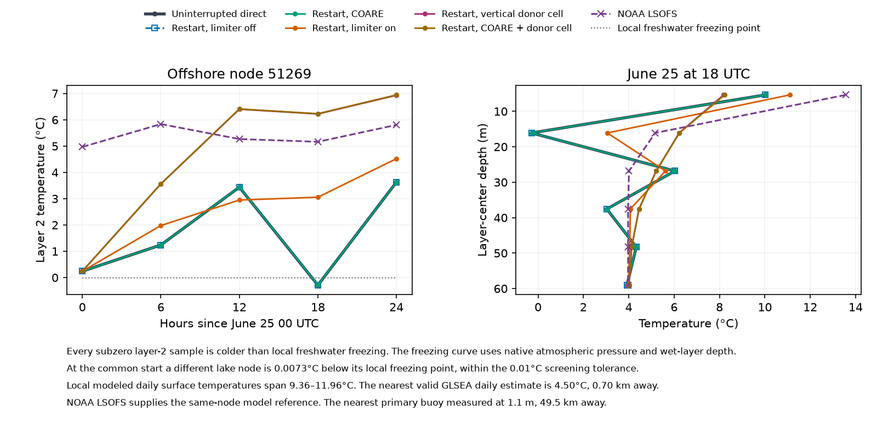

# Lake Superior subfreezing temperature tests

Two separate changes corrected the observed June 2025 failures in matched 24-hour Perlmutter runs. HRRR supplied the weather, surface stress and pressure. The shoreline heat calculation used the evolving lake surface temperature. Offshore, the temperature calculation used the upstream layer temperature for the heat crossing each vertical face. The combined and heat-only runs for each day used identical initial conditions, namelist, weather, rivers and 128-rank layout. Both changes ran without a temperature floor.

| Location and UTC | Prescribed heat, centered transport | SST-dependent heat, centered transport | SST-dependent heat, donor transport | NOAA LSOFS at the same wet node and layer |
|---|---:|---:|---:|---:|
| June 7 12 UTC, north shore, surface | −1.95 °C | 5.25 °C | 5.24 °C | 10.59 °C |
| June 25 18 UTC, offshore, 16.1 m below surface | −0.29 °C | −0.28 °C | 6.23 °C | 5.16 °C |

At the shore, heat retained in the 0.31 m column went from −179.03 to +38.70 W/m². The combined run's daily surface mean was 7.58 °C against 11.30 °C at the nearest valid GLSEA satellite pixel, 2.57 km away. Offshore, centered vertical advection removed 5.18 °C over the six hours leading to the event. Changing only vertical transport raised the 18 UTC layer temperature by 6.51 °C. Changing only surface heat raised it by 0.007 °C. [Shoreline temperatures and observations](shoreline_june7.csv) · [Offshore temperature profiles and freezing margins](offshore_temperature.csv)

**Stratification remains a limitation.** The combined run removed the inversion between the second and third layers. The temperature drop per meter between the top two layer centers was 0.186 °C/m, against 0.782 °C/m in NOAA. Across all 20 layers and five saved clocks at this node, RMS difference from NOAA changed from 1.23 to 1.20 °C. At NDBC 45001, the simulated temperature at the 1.1 m sensor was still 7.08 °C warm on average over 25 hours. Median absolute thermocline-depth error was 4 m at both GLOS thermistor chains on the clocks common to all methods. The donor runs missed three additional detections at station 45023. [Scores and observation coverage](offshore_case_scores.csv)

| Combined run | Perlmutter model / native audit / independent audit | Wet-field freezing screen | Daily heat residual | Daily water residual |
|---|---|---|---:|---:|
| June 7–8 | 62023088 / 62023132 / 62023157 | Passed all five clocks | −1.223 W/m² | +8,866 m³ |
| June 25–26 | 62023072 / 62023101 / 62023134 | Passed all five clocks | −2.670 W/m² | +10,200 m³ |

The June 25 checkpoint contained a −0.022 °C sample elsewhere in the lake, 0.007 °C below its local freezing point and within the predeclared 0.01 °C tolerance. All 173 subsequent temperature reports sampled at 500-second intervals were above zero. On June 7 the lowest of 174 reports was 1.324 °C. Each independent audit checked 151 native point evaluations and accounted for 17,280 internal steps and 34,560 external steps.

The earlier June 26 Chequamegon Bay repeat with SST-dependent heat raised the wet surface from −1.99 to 11.35 °C against NOAA's 13.98 °C. At the warm Sturgeon Bay site on June 19 it lowered 24.84 to 14.18 °C against NOAA's 16.29 °C. The original 7-, 14- and 28-day spin-up trials each developed a subfreezing excursion. No July restart was selected. The combined treatment is available for spin-up qualification. [Earlier shoreline tests](shoreline_temperature_comparison.csv)
